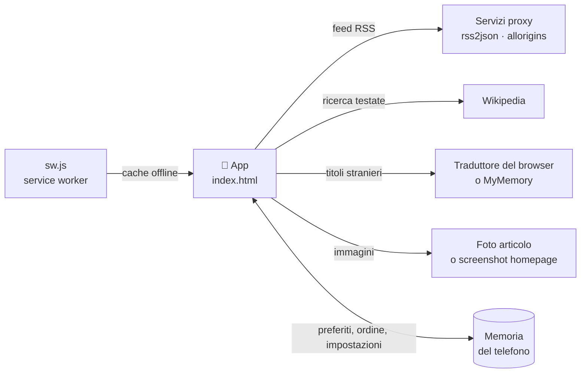

<div align="center">

# 📰 TestateMondiali

### I giornali di tutto il mondo, in tasca

*Titoli, anteprime e ultime notizie delle principali testate, divise per continente e nazione.*

<br>


<br>

**[🌐 Apri l'app](https://michelef1.github.io/TestateMondiali/)** · **[📖 Guida](#-come-si-usa)** · **[🛠️ Pubblicazione](#️-installazione-e-pubblicazione)**

</div>

---

## ✨ Cos'è

**TestateMondiali** è una Progressive Web App pensata per lo smartphone. Raccoglie in un'unica schermata le principali testate giornalistiche del mondo, le organizza per **continente › nazione › tipo** e ti mostra i titoli più recenti, anche **tradotti in italiano**, prima ancora di aprire l'articolo.

Nasce da un elenco di testate in PDF ed è cresciuta fino a diventare un piccolo lettore di notizie internazionale, **senza server, senza account e senza pubblicità**.

---

## 🚀 Funzioni principali

| | Funzione | Cosa fa |
|:-:|---|---|
| 🏠 | **Home a copertine** | Anteprime con immagine, due per riga, oppure tessere compatte con solo nome, continente e nazione |
| 🔴 | **Ultime notizie** | L'ultimo titolo di ogni testata con feed, ordinato per novità, con bandierina e orario |
| 🌐 | **Traduci titoli** | Traduzione in italiano dei titoli stranieri, con l'originale sotto in corsivo |
| 🔎 | **Cerca nel mondo** | Ricerca tra le tue testate, nel catalogo e su Wikipedia |
| 🌍 | **Sfoglia il mondo** | Tutte le testate del catalogo, per continente e nazione |
| 📚 | **Catalogo** | **175 testate in 71 nazioni** da aggiungere con un tocco |
| ➕ | **Aggiungi e modifica** | Aggiungi, modifica o elimina una testata, sempre con conferma Sì/No |
| ⭐ | **Preferiti in cartelle** | Salva le testate in cartelle con il nome della nazione o quello che vuoi |
| ↕️ | **Organizza la home** | Sposta le testate di una posizione alla volta, oppure ordine alfabetico |
| 🎨 | **Temi a gradiente** | Chiaro, scuro o automatico, con 6 sfondi e 4 dimensioni del testo |
| 📶 | **Offline** | I contenuti già visti restano disponibili, con avviso quando sei senza rete |
| 💾 | **Esporta e importa** | Salva e ripristina preferiti, ordine e impostazioni in un file |

---

## 📱 Come si usa

<details open>
<summary><b>☰ Il menu laterale</b></summary>

<br>

| Sezione | Voci |
|---|---|
| **Principale** | 🏠 Home · ⭐ Preferiti · 🔴 Ultime notizie |
| **Filtri** | Tipo (quotidiano, sport, economia, agenzia) · Continente · Nazione |
| **Scopri** | 🌍 Sfoglia il mondo · 📚 Catalogo testate |
| **Gestisci** | ↕️ Organizza la home · ➕ Aggiungi un giornale · 🔄 Aggiorna titoli |
| **App** | ⚙️ Impostazioni · 📖 Guida · ℹ️ Info |

</details>

<details open>
<summary><b>⋮ Il menu in alto a destra</b></summary>

<br>

⬇️ **Installa app** · 📖 **Guida di come funziona** · ⚙️ **Impostazioni** · ℹ️ **Info App Creata da Miki** · 🌙 **Tema chiaro/scuro**

</details>

<details open>
<summary><b>👆 Gesti e scorciatoie</b></summary>

<br>

- Tocca il titolo **TestateMondiali** per tornare alla home e svuotare la ricerca
- Il tasto **indietro** del telefono riporta sempre alla home
- Tira la schermata verso il basso per aggiornare i titoli
- Il pulsante blu **➕** in basso a destra aggiunge un giornale
- Dall'icona dell'app, tieni premuto per le scorciatoie **Preferiti**, **Organizza** e **Catalogo**
- Tocca il nome di una testata per aprirla nel browser esterno, per esempio Opera, e usare il suo traduttore

</details>

---

## 🛠️ Installazione e pubblicazione

### Installarla sul telefono

1. Apri il link dell'app con **Chrome** su Android
2. Tocca **⋮ › Installa app** (oppure la voce **Installa app** dentro l'app)
3. L'icona compare nella schermata Home e si apre a schermo intero

### Pubblicarla su GitHub Pages

1. Crea un repository, per esempio `TestateMondiali`
2. Carica i file rispettando questa struttura (le icone vanno **nella sottocartella `icons/`**)
3. Vai in **Settings › Pages**, scegli il ramo `main` e la cartella `/ (root)`
4. Dopo qualche minuto l'app è online su `https://<tuo-utente>.github.io/<repository>/`

---

## 🗂️ Struttura del progetto

```text
TestateMondiali/
├── index.html          # tutta l'app: HTML, CSS e JavaScript
├── manifest.json       # nome, colori, icone e scorciatoie
├── sw.js               # service worker: cache e funzionamento offline
├── README.md           # questo file
└── icons/
    ├── icon-192.png
    ├── icon-512.png
    ├── maskable-192.png
    └── maskable-512.png
```

> Tutto è in **JavaScript puro**: nessun framework, nessuna dipendenza da installare, nessuna fase di build.

---

## ⚙️ Come funziona



- I **titoli** arrivano dai feed RSS delle testate, tramite servizi gratuiti
- Le **anteprime** usano la foto dell'ultimo articolo, oppure uno screenshot della homepage
- La **traduzione** usa il traduttore del browser, se presente, altrimenti MyMemory; le traduzioni già fatte vengono ricordate
- Tutti i **tuoi dati** restano nel telefono

---

## ⚠️ Cose da sapere

| Tema | Dettaglio |
|---|---|
| **Feed RSS** | Non tutte le testate ne hanno uno: quelle senza feed non compaiono in *Ultime notizie*. Alcuni indirizzi potrebbero smettere di rispondere e vanno corretti |
| **Servizi gratuiti** | Proxy RSS, Wikipedia, screenshot e traduzione hanno limiti di richieste: in certi momenti potrebbero rallentare o non rispondere |
| **Traduzione** | È automatica e indicativa, soprattutto per russo e portoghese |
| **Notifiche** | Sono locali e opzionali, senza server: non arrivano ad app chiusa |
| **Opera** | La scelta "Opera" nelle impostazioni funziona su Android; se l'app non è installata si usa il browser predefinito |
| **Offline** | Titoli e testi già visti restano disponibili, mentre le immagini di anteprima possono mancare |

---

## 🔒 Privacy

- Nessun account, nessun tracciamento, nessuna pubblicità
- Preferiti, cartelle, ordine e impostazioni sono salvati **solo sul tuo dispositivo**
- Per mostrare titoli, immagini e traduzioni l'app contatta i servizi elencati sopra, che ricevono l'indirizzo della testata o il testo del titolo da tradurre

---

## 🔄 Aggiornare l'app

Quando modifichi il codice:

1. aumenta il numero di versione (`VER` dentro `index.html`)
2. aumenta di pari passo il nome della cache nel file `sw.js` (per esempio `testatemondiali-v17` diventa `testatemondiali-v18`)
3. carica i file sul repository
4. sul telefono **chiudi e riapri l'app due volte** per vedere la nuova versione

---

## 🕓 Cronologia

| Versione | Novità |
|:-:|---|
| **1.0** | Prima versione: elenco dal PDF, menu laterale, guida, info, preferiti |
| **1.1 – 1.2** | Tema esteso a tutto lo sfondo, impostazioni con gradienti e dimensione testo, tasto Chiudi |
| **1.3 – 1.4** | Aggiungi ed elimina testate, anteprime reali con foto |
| **1.5 – 1.10** | Ricerca e filtri, catalogo, home riordinata, tessere Titoli, titolo che porta in home |
| **1.11 – 1.18** | Ricerca nel mondo, Sfoglia il mondo, Wikipedia, modifica, ordine alfabetico, pull-to-refresh, avviso offline |
| **1.19** | Scorciatoie dell'icona, cache immagini corretta, titolo che svuota la ricerca |
| **1.20** | 🔴 Pagina *Ultime notizie* con filtri e 30 feed aggiunti |
| **1.21** | 🌐 Traduzione dei titoli |
| **1.22** | Correzione di "Aggiungi un giornale" dal menu laterale |
| **1.23** | Etichette del menu in giallo e pulsante blu **➕** in home |

---

## 🙌 Crediti

**App Creata da Miki by Claude**

I nomi e i marchi delle testate appartengono ai rispettivi editori. L'app mostra solo titoli e collegamenti verso gli articoli originali.

<div align="center">

<br>

*Fatta con cura, per leggere il mondo un titolo alla volta.* 📰

</div>
